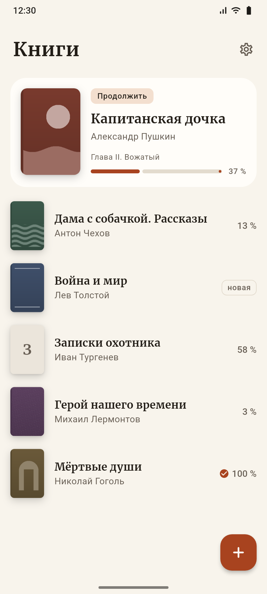
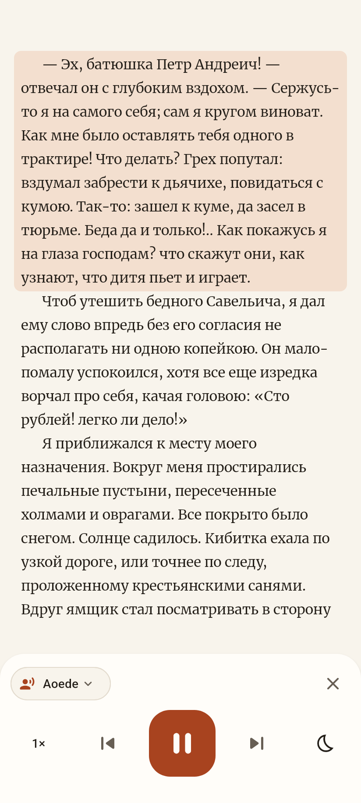
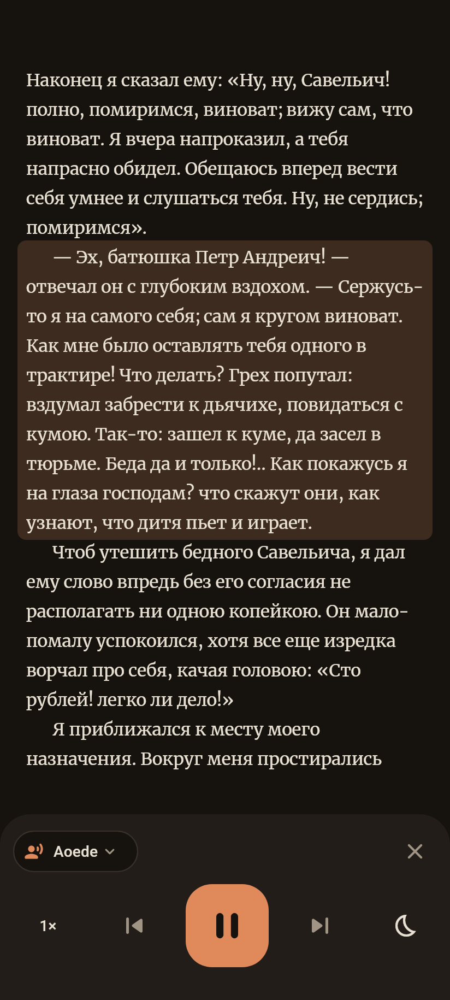

<p align="center">
  
</p>

# AudiobookReader

Читалка книг для Android, которая читает вслух голосами Google Gemini TTS. Одна позиция на чтение и прослушивание:
можно читать глазами, включить голос с любого абзаца и вернуться к тексту там, где он остановился.

Приложение одного пользователя: без сервера, учётных записей и синхронизации. Ключ Gemini — свой, хранится на
телефоне в защищённом хранилище Android.

<p align="center">
  
  
  
  
</p>

## Что умеет

- **Книги:** FB2, FB2.ZIP, EPUB и TXT — кнопкой «+», через «Открыть с помощью» и «Поделиться». Оглавление, сноски,
  картинки, стихи.
- **Чтение:** страницы, светлая и тёмная тема, размер шрифта; позиция сохраняется сама.
- **Озвучка:** «Слушать» с любого абзаца, звучащий абзац подсвечен, страница листается за голосом. «Назад» и
  «вперёд» — по абзацам, скорость, таймер сна, выбор голоса с пробой.
- **Фон:** звук идёт при погашенном экране; управление — из уведомления, с экрана блокировки и с гарнитуры.
- **Деньги на виду:** озвученное хранится на телефоне и второй раз не оплачивается; расход показан в настройках;
  главу можно скачать заранее, оценка цены видна до нажатия.
- **Языки интерфейса:** русский, английский, польский, немецкий.

Чего приложение не делает и почему — [docs/CONCEPT.md](docs/CONCEPT.md), раздел «Чего не делаем».

## Состояние

Версия 0.1.0, в разработке. Чтение принято владельцем на телефоне; озвучка написана и проверяется на телефоне;
в магазине приложений его нет. Что сделано и что дальше — [docs/WHERE_WE_ARE.md](docs/WHERE_WE_ARE.md).

## Сборка и проверка

Рабочее окружение — Linux или WSL Debian. Flutter 3.50.0, JDK и Android SDK закреплённых версий ставит скрипт;
в Windows Flutter не нужен.

```sh
bash scripts/setup-wsl.sh           # один раз: Flutter, JDK, Android SDK в ~/sdk, пакеты
bash scripts/test.sh                # анализатор без замечаний и все тесты
bash scripts/build-apk.sh --debug   # APK отладочным ключом → build/app/outputs/flutter-apk/
bash scripts/build-apk.sh           # APK постоянным ключом из .env (см. .env.example)
bash scripts/build-apk.sh --fake    # отдельное приложение с подставным голосом — без ключа и без расходов
bash scripts/prototype.sh start     # веб-прототип экранов на http://127.0.0.1:8642/
```

Из Windows те же команды запускаются через `wsl.exe -d Debian --cd "<каталог проекта>" -- bash scripts/…`;
подробности и грабли рабочего места — в [AGENTS.md](AGENTS.md), «Стек и runtime».

Тесты никогда не обращаются к Gemini: синтез в них подставной. Android требуется 12 и новее (`minSdk 31`).

Установка на телефон: `adb install -r build/app/outputs/flutter-apk/app-real-release.apk`. Ключ Gemini вводится в
настройках приложения; получить его можно в Google AI Studio.

## Устройство кода

```
lib/
  app/        корень сборки: связывает модули, тема
  screens/    экраны и строки интерфейса (ARB, четыре языка)
  reader/     раскладка текста по страницам
  playback/   контроллер озвучки, очередь синтеза, плеер, таймер сна, «Скачать главу»
  library/    полка и хранение на файлах, настройки, расход
  tts/        клиент Gemini TTS, деление текста на отрезки, голоса
  audio/      хранилище звука и кодировщик
  platform/   каналы к Android: файлы, кодировщик AAC, медиасессия
  book/       модель книги и разборщики FB2 / EPUB / TXT
android/      оболочка Android (Kotlin): приём файлов, кодировщик, служба плеера
test/         тесты; правила зависимостей между модулями проверяет architecture_test.dart
scripts/      установка окружения, тесты, сборка, прототип
docs/         концепция, архитектура, спеки, ревью
```

Кто от кого может зависеть и почему — [docs/ARCHITECTURE.md](docs/ARCHITECTURE.md), раздел 2.

## Документы

| Документ | О чём |
|---|---|
| [docs/WHERE_WE_ARE.md](docs/WHERE_WE_ARE.md) | состояние и следующий шаг — читать первым |
| [docs/CONCEPT.md](docs/CONCEPT.md) | что строим и чего не строим |
| [docs/ARCHITECTURE.md](docs/ARCHITECTURE.md) | модули, модель книги, раскладка, озвучка, хранение |
| [docs/specs/001-first-version.md](docs/specs/001-first-version.md) | спека первой версии: требования, приёмка, журнал решений |
| [docs/GEMINI_TTS.md](docs/GEMINI_TTS.md) | запрос к Gemini TTS, голоса, цена, замеры |
| [docs/DEVICE_CHECKLIST.md](docs/DEVICE_CHECKLIST.md) | что проверяется только на телефоне |
| [docs/README.md](docs/README.md) | полный указатель документов, включая ревью |
| [CHANGELOG.md](CHANGELOG.md) | что менялось для читателя |
| [AGENTS.md](AGENTS.md) | правила работы для ассистентов и автоматизации |

Если документ и код расходятся, прав код.

## Права

Лицензия не выбрана: код принадлежит автору, все права сохранены. Шрифты Merriweather и Roboto в `assets/fonts/`
распространяются по SIL Open Font License (тексты лицензий лежат рядом).

Родственные проекты автора: DocxAICorrector (перевод и подготовка книг) и AudiobookStudio (озвучка книги в mp3 по
главам).
