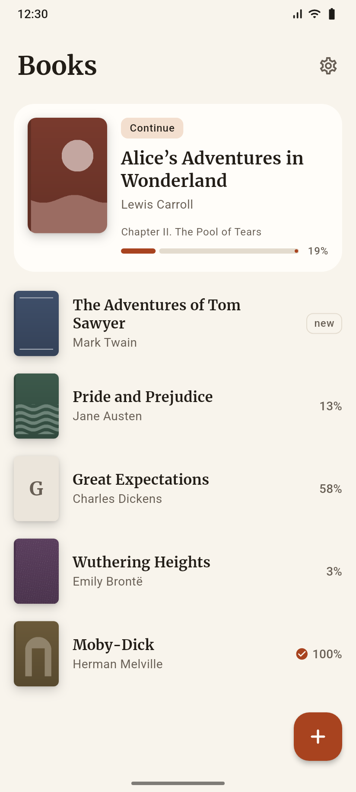
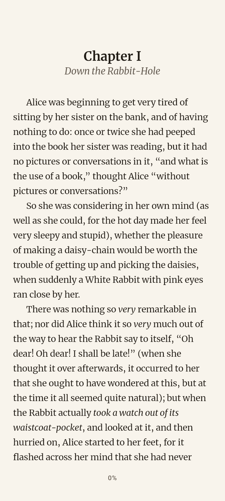
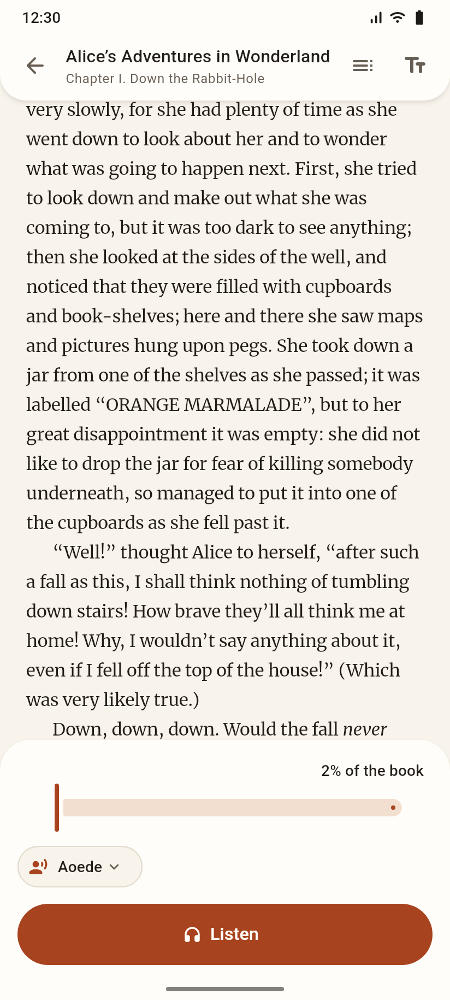
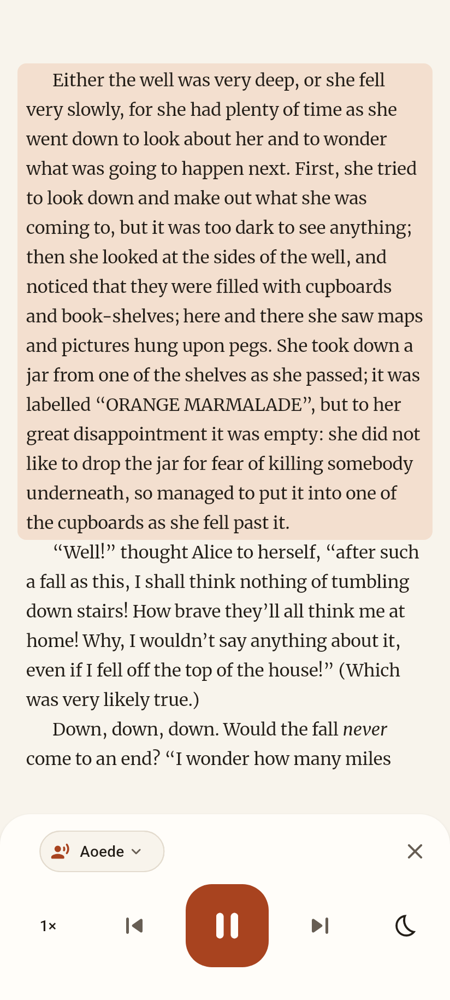
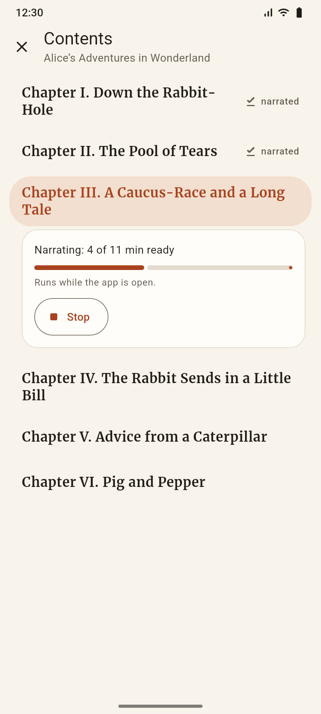
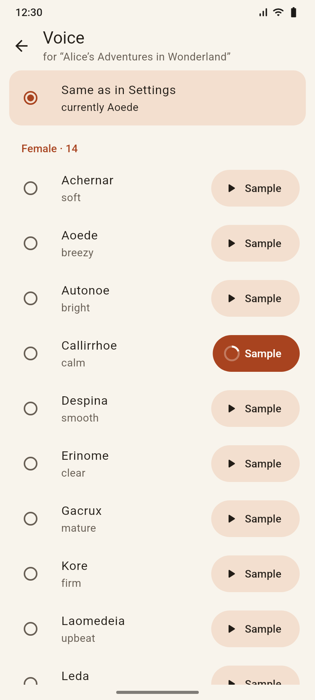
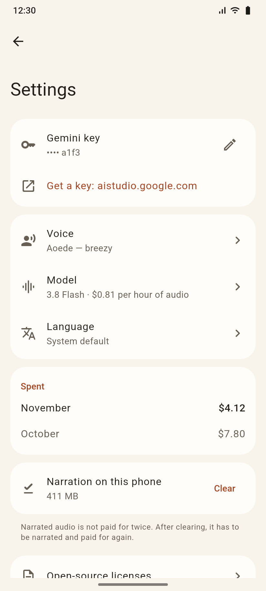
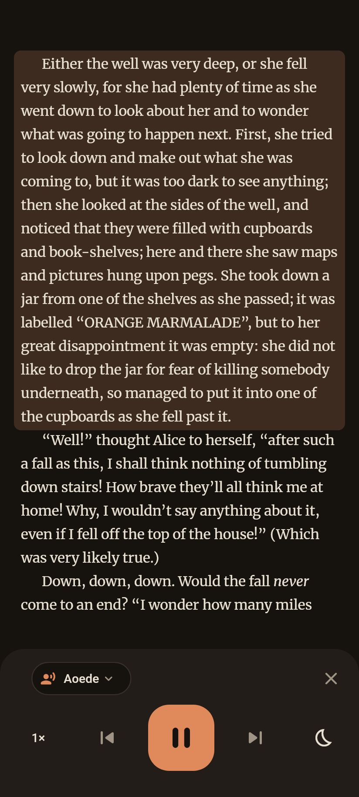

<p align="center">
  
</p>

# Book AudioReader

Book AudioReader is an Android book reader that reads aloud with Google Gemini TTS voices. One position for reading and
listening: read with your eyes, start the voice from any paragraph, and return to the text where it stopped. The
Dart package and the Android applicationId keep the working name `audiobook_reader`.

It is a single-user app: no server, no accounts, no sync. The Gemini key is your own and is kept on the phone in
Android's secure storage.

## Features

- **Books:** FB2, FB2.ZIP, EPUB and TXT — with the "+" button, through "Open with" and through "Share". Table of
  contents, footnotes, images, verse.
- **Reading:** pages, light and dark themes, font size; the position is saved automatically.
- **Narration:** "Listen" from any paragraph, the sounding paragraph is highlighted, the page turns after the voice.
  "Back" and "forward" move by paragraphs; speed, sleep timer, voice choice with a voice probe.
- **Background:** the sound plays with the screen off; control from the notification, the lock screen and the headset.
- **Money in view:** what has been narrated is stored on the phone and is not paid for a second time; the spend is
  shown in settings; a chapter can be downloaded in advance, and its price estimate is shown before you press.
- **Interface languages:** Russian, English, Polish, German, Ukrainian.

What the app does not do, and why — [docs/CONCEPT.md](docs/CONCEPT.md), section 7, "Out of scope".

## Screenshots

<table>
  <tr>
    <td align="center" valign="top" width="25%">
      <br>
      <sub>Shelf</sub>
    </td>
    <td align="center" valign="top" width="25%">
      <br>
      <sub>Reading</sub>
    </td>
    <td align="center" valign="top" width="25%">
      <br>
      <sub>Panels</sub>
    </td>
    <td align="center" valign="top" width="25%">
      <br>
      <sub>Listening</sub>
    </td>
  </tr>
  <tr>
    <td align="center" valign="top" width="25%">
      <br>
      <sub>Contents and narration</sub>
    </td>
    <td align="center" valign="top" width="25%">
      <br>
      <sub>Voice</sub>
    </td>
    <td align="center" valign="top" width="25%">
      <br>
      <sub>Settings</sub>
    </td>
    <td align="center" valign="top" width="25%">
      <br>
      <sub>Dark theme</sub>
    </td>
  </tr>
</table>

The screenshots are taken by a test on the prototype's fake data: the book is the opening of *Alice's Adventures in
Wonderland* (public domain, Project Gutenberg); nothing is narrated or paid for.

## Requirements and cost

- Android 12 or newer (`minSdk 31`).
- **Your own Gemini API key** (get one in Google AI Studio), entered in the app's settings. Narration is paid by you
  directly to Google; the project has no server and takes no payment.
- Narration is paid: about $0.8 per hour of audio until 2026-12-31 and about $1.6 from 2027-01-01 on the default model
  (3.8 Flash); a book of 500 thousand characters is about $8 and $15 respectively. The calculation and the
  measurements are in [docs/GEMINI_TTS.md](docs/GEMINI_TTS.md), section "Price". Only a small reserve is narrated ahead,
  not the whole book; the spent counter is computed from the tokens Google actually billed.
- Only Gemini needs the network: no analytics, no crash reports, no book catalogs. The text of a paragraph sent for
  narration is the only thing that leaves the phone.

## Status

Version 0.1.0 is the first release (2026-11-17): the [signed APK](https://github.com/slawa19/BookAudioReader/releases/tag/v0.1.0)
is published with a checksum and a build-provenance attestation; how to verify it is in
[docs/RELEASING.md](docs/RELEASING.md). All the planned features of the first version are written.
Reading has been accepted by the owner on the phone. Narration, the player and background playback have been passed on
the phone by the checklist; what remains for the owner is what can only be done by hand and by ear: the lock screen,
headphones, a phone call. What has been done and what is next — [docs/WHERE_WE_ARE.md](docs/WHERE_WE_ARE.md).

## Install

Signed APKs are published on the [Releases page](https://github.com/slawa19/BookAudioReader/releases) (the first one,
[v0.1.0](https://github.com/slawa19/BookAudioReader/releases/tag/v0.1.0), is out): GitHub Actions builds them from a
version tag. Download the APK and open it on the phone (Android asks to allow installs from your browser or file
manager). How to verify the file before installing it: [docs/RELEASING.md](docs/RELEASING.md). You can also build the
app yourself, as below.

To install an APK you built yourself: `adb install -r build/app/outputs/flutter-apk/app-real-release.apk`.

## Build from source

The working environment is Linux or WSL Debian. The script installs the pinned versions of Flutter 3.50.0, the JDK and
the Android SDK; Flutter is not needed in Windows.

```sh
bash scripts/setup-wsl.sh           # once: Flutter, JDK, Android SDK in ~/sdk, packages
bash scripts/test.sh                # the analyzer with no findings and all tests
bash scripts/build-apk.sh --debug   # APK with the debug key → build/app/outputs/flutter-apk/
bash scripts/build-apk.sh           # APK with the permanent key from .env (see .env.example)
bash scripts/build-apk.sh --debug --fake   # a separate app with a fake voice: no Gemini key, no cost
bash scripts/prototype.sh start     # the web prototype of the screens at http://127.0.0.1:8642/
```

From Windows the same commands are run through `wsl.exe -d Debian --cd "<project directory>" -- bash scripts/…`;
details and pitfalls of the maintainer's workplace are in [AGENTS.md](AGENTS.md), "Stack and runtime".

Tests never call Gemini: synthesis in them is fake.

## Code layout

```
lib/
  app/        the composition root: connects the modules, the theme
  screens/    screens and interface strings (ARB, five languages)
  reader/     laying the text out into pages
  playback/   the narration controller, the synthesis queue, the player, the sleep timer, "Download chapter"
  library/    the shelf and file-based storage, settings, spend
  tts/        the Gemini TTS client, splitting the text into pieces, voices
  audio/      the audio store and the encoder
  platform/   channels to Android: files, the AAC encoder, the media session
  book/       the book model and the FB2 / EPUB / TXT parsers
android/      the Android shell (Kotlin): file intake, the encoder, the player service
test/         tests; the dependency rules between modules are checked by architecture_test.dart
scripts/      environment setup, tests, build, prototype
docs/         concept, architecture, specs, reviews
```

Who may depend on whom and why — [docs/ARCHITECTURE.md](docs/ARCHITECTURE.md), section 2.

## Documentation

| Document | What it is about |
|---|---|
| [docs/WHERE_WE_ARE.md](docs/WHERE_WE_ARE.md) | the state and the next step — read first |
| [docs/CONCEPT.md](docs/CONCEPT.md) | what we build and what we do not |
| [docs/ARCHITECTURE.md](docs/ARCHITECTURE.md) | modules, the book model, layout, narration, storage |
| [docs/specs/001-first-version.md](docs/specs/001-first-version.md) | the first-version spec: requirements, acceptance, the decision log |
| [docs/specs/003-open-source.md](docs/specs/003-open-source.md) | the open-source publication spec: license, English documentation, Ukrainian, releases |
| [docs/GEMINI_TTS.md](docs/GEMINI_TTS.md) | the Gemini TTS request, voices, price, measurements |
| [docs/RELEASING.md](docs/RELEASING.md) | verifying a signed APK; cutting a release |
| [docs/DEVICE_CHECKLIST.md](docs/DEVICE_CHECKLIST.md) | what is checked only on a phone |
| [docs/README.md](docs/README.md) | the full index of documents, including reviews |
| [CHANGELOG.md](CHANGELOG.md) | what changed for the reader |
| [AGENTS.md](AGENTS.md) | working rules for assistants and automation |

If a document and the code disagree, the code is right.

## License

Copyright (C) 2026 Slawa Gorobets

Book AudioReader is free software: you can redistribute it and/or modify it under the terms of the GNU General Public
License as published by the Free Software Foundation, either version 3 of the License, or (at your option) any later
version (GPL-3.0-or-later). It is distributed in the hope that it will be useful, but WITHOUT ANY WARRANTY; without even
the implied warranty of MERCHANTABILITY or FITNESS FOR A PARTICULAR PURPOSE. See the GNU General Public License for more
details. The full text is in the [`LICENSE`](LICENSE) file; if you did not receive it, see
<https://www.gnu.org/licenses/>.

All source files in this repository are under this license unless stated otherwise. The exceptions:

- The fonts Merriweather and Roboto in `assets/fonts/` are under the SIL Open Font License 1.1 (the license texts are
  next to them, the sources are in `assets/fonts/SOURCES.txt`).
- The demo texts in `assets/demo/` are public-domain works (Pushkin, Chekhov) taken from Wikisource; three short
  editorial notes in the Pushkin text are (c) Wikisource contributors, CC BY-SA 4.0. The sources and revisions are in
  `assets/demo/SOURCES.txt`. The demo covers and the illustration are drawn by a script and are under the project
  license.
- The English demo book behind the screenshots above, `test/fixtures/screenshots_en/` (Lewis Carroll, public domain,
  from Project Gutenberg without its markers and license text), is a test fixture and is not part of the app; see its
  `SOURCES.txt`.

The app shows the notices of what it bundles (the project license, the two font licenses, the demo-text sources with
the CC BY-SA attribution) and those of the libraries it uses in Settings, "Open-source licenses".

The author's related projects: DocxAICorrector (translating and preparing books) and AudiobookStudio (narrating a book
to mp3 by chapters).

## Disclaimer

This project is not affiliated with, endorsed by or sponsored by Google. Gemini and Android are trademarks of
Google LLC.
